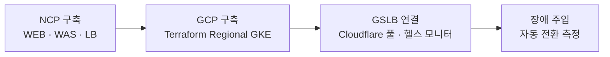

<!--
  NCP-GCP 멀티클라우드 DR 상세 본문. 표준: content/projects/STYLE.md
  출처: 포트폴리오 PDF(2026) PROJECT 02, 네이버클라우드 팀9 최종 발표자료, 현대오토에버 지원서
-->

> NCP Active · GCP Warm Standby 멀티클라우드 DR을 구성하고, 장애를 주입해 GCP 자동 전환 20.7초를 측정했다.

---

## 프로젝트 요약

| 항목 | 내용 |
| --- | --- |
| 소속 | 네이버 클라우드 아카데미 Advanced 과정 |
| 기간 | 2026.01 (약 5일) |
| 형태 | 5인 팀 (NCP 인프라 3명, GCP 인프라 2명) |
| 역할 | PM · GCP 인프라 담당 |
| 담당 범위 | GCP Warm Standby 환경, Cloudflare GSLB 전환 구성, 배포 자동화, 전환 측정 |

### 핵심 성과

- 서비스 컨테이너 종료 후 20.7초 만에 GCP 첫 정상 응답, 팀 목표 RTO 1분 충족
- 기존 환경 재시작(43.7초)보다 23초 먼저 서비스 정상화
- 수동 풀 비활성화 스모크 테스트 HTTP 요청 140건 전부 정상 응답
- 과정 프로젝트 1위, 최우수 수료생 선정

### 주요 기여

- Terraform으로 GCP Regional GKE 예비 환경 구성
- Cloudflare GSLB 우선순위 기반 Failover 정책 설계
- Argo Rollouts 카나리 배포, Workload Identity Federation 기반 키 없는 GKE 배포
- 장애 주입 테스트와 요청 자동 기록으로 RTO 측정

---

## 1. 프로젝트 개요

### 1.1 배경

2025년 9월 국가정보자원관리원 화재와 10월 AWS us-east-1 장애로 하나의 인프라에 묶인 서비스가 연쇄적으로 중단됐다. 같은 리전 안에서 이중화를 해도 리전 전체가 무너지면 그 안의 서비스는 함께 멈춘다.

### 1.2 문제 정의

예비 환경과 자동 전환이 없으면 장애 시간은 원래 클라우드의 복구 시간에 묶인다. 원래 클라우드가 복구될 때까지 기다릴 수밖에 없고, DNS를 손으로 바꾸는 방식은 전환 시점을 예측할 수 없으며, 전환에 걸린 시간도 측정되지 않는다. 특정 CSP에 종속되지 않고 다른 클라우드가 자동으로 서비스를 이어받는 구조가 필요했다.

### 1.3 목표와 요구사항

| 목표 | 기준 |
| --- | --- |
| 장애 조치 | NCP 장애 시 GCP로 자동 전환, 팀 목표 RTO 1분 |
| 무중단 배포 | 새 버전을 단계적으로 반영 |
| 관측 데이터 보존 | Prometheus Remote Write로 메트릭 손실 최소화 (목표 RPO near-zero, 메트릭 기준) |
| 재현 가능성 | 대기 환경을 Terraform으로 코드화해 같은 구성을 다시 생성 |

### 1.4 제약 조건

- 5일 안에 양쪽 클라우드 구축과 전환 검증까지 완료
- DB 복제·승격은 검증 범위 밖, WEB·WAS 계층을 대상으로 구성

---

## 2. 시스템 설계

### 2.1 전체 아키텍처

Cloudflare Load Balancing이 평시에는 NCP로 요청을 보내고, NCP 헬스체크가 실패하면 GCP로 보낸다. GCP는 서울 리전(`asia-northeast3`)의 GKE Regional Cluster에 WEB(Next.js)과 WAS(Spring Boot)를 미리 띄워 둔 Warm Standby다.

NCP Active는 NKS 클러스터에 Frontend(Rollout), Argo Rollouts Controller, 모니터링(Prometheus · Grafana)을 올렸고, 관리 접속은 Public Subnet의 Bastion으로만 열었다. GCP의 Prometheus는 mTLS와 IP 제한을 건 Remote Write로 NCP Prometheus에 메트릭을 보내, 어느 쪽이 서비스하든 한 곳에서 관측한다.

### 2.2 설계 의사결정

| 결정 | 근거 |
| --- | --- |
| Active-Warm Standby | 평시 비용을 줄이면서 전환 시 바로 응답할 수 있도록 GCP에 애플리케이션을 미리 기동 |
| 가중치 분산 대신 우선순위 Failover | DB 복제·승격 검증 전이라 양쪽에 요청을 나누면 데이터 정합성을 보장하기 어려움 |
| GCP 환경 Terraform 코드화 | 장애 시 같은 구성을 다시 만들 수 있어야 함 |
| Workload Identity Federation | GitHub Actions에 서비스 계정 키 파일을 두지 않음 |
| Argo Rollouts 카나리 | 문제 버전이 모든 요청에 즉시 노출되는 것을 차단 |

### 2.3 기술 스택

| 분류 | 기술 | 사용 목적 |
| --- | --- | --- |
| 트래픽 | Cloudflare Load Balancing | 헬스체크 기반 GSLB Failover |
| GCP | GKE Regional Cluster, External Application LB, Cloud NAT | Warm Standby 실행 환경 |
| NCP | NKS, Load Balancer, Bastion | Active 실행 환경 |
| IaC | Terraform, Cloud Storage | GCP 환경 코드화, state 저장 |
| 배포 | GitHub Actions, Docker, Artifact Registry, Argo Rollouts | 이미지 빌드·배포, 카나리 반영 |
| 관측 | Prometheus, Grafana | 양쪽 메트릭 통합 |
| 보안 | Secret Manager, IAM, Workload Identity Federation | Secret 관리, 키 없는 인증 |

---

## 3. 주요 구현

### 3.1 GSLB 전환 정책

Cloudflare 풀 순서를 NCP 1순위, GCP 2순위로 두고 헬스체크가 실패할 때만 GCP로 전환한다. 평시 트래픽은 NCP Active만 처리하고, GCP는 요청을 받지 않는 대기 상태로 남는다.

### 3.2 환경별 설정 분리

Web의 Public Origin처럼 환경마다 달라야 하는 값은 ConfigMap으로 분리해 환경별로 주입한다. GCP 설정이 NCP 도메인이나 자원을 참조하지 않게 해, NCP가 내려가도 GCP가 독립적으로 서비스한다.

### 3.3 카나리 배포

Argo Rollouts로 레플리카 10개 기준 10%, 50%, 100% 순서로 반영하고, 단계마다 1분씩 대기한다. GitHub Actions는 Workload Identity Federation으로 GKE에 인증해 서비스 계정 키 파일 없이 배포한다.

### 3.4 구축 흐름

---

## 4. 트러블슈팅

### 4.1 가중치 분산은 평시에도 예비 환경으로 요청을 보냄

<dl>
<dt>요약</dt>
<dd>가중치 분산을 우선순위 Failover로 바꿔 평시 트래픽을 NCP에만 보내고, 전환 경로는 스모크 테스트 140건으로 확인했다.</dd>
<dt>현상</dt>
<dd>초기에 Cloudflare에서 NCP와 GCP를 90:10 가중치로 나누자, 평시에도 요청의 10%가 GCP로 전달됐다.</dd>
<dt>원인 분석</dt>
<dd>가중치 분산은 장애 여부와 무관하게 트래픽을 나눈다. Warm Standby가 상시 운영 환경이 되고, 아직 DB 복제·승격을 검증하지 않은 상태라 양쪽에서 요청을 처리하면 데이터 정합성을 보장할 수 없었다.</dd>
<dt>해결</dt>
<dd>풀 순서를 NCP 우선으로 두고 헬스체크 실패 시에만 GCP로 넘어가는 우선순위 Failover로 바꿨다. 수동 풀 비활성화는 라우팅 경로 확인용 스모크 테스트로만 쓰고, 복구 시간은 별도 Failover 테스트로 측정했다.</dd>
<dt>검증</dt>
<dd>평시 트래픽이 NCP로만 들어가는 것을 확인했고, 수동 전환 스모크 테스트 HTTP 요청 140건이 모두 정상 응답했다.</dd>
</dl>

### 4.2 GCP로 전환돼도 사용자가 NCP 도메인으로 되돌아감

<dl>
<dt>요약</dt>
<dd>NCP 도메인에 고정된 Public Origin을 ConfigMap으로 분리해, 전환 후에도 GCP가 같은 도메인에서 서비스하게 했다.</dd>
<dt>현상</dt>
<dd>전환 테스트 중 GCP로 넘어간 사용자가 로그인만 하면 NCP 도메인으로 리다이렉트됐다.</dd>
<dt>원인 분석</dt>
<dd>Web의 기본 Public Origin이 NCP 도메인으로 고정돼 있었다. 트래픽은 GCP로 왔지만 애플리케이션이 다시 장애 난 NCP를 가리켰다.</dd>
<dt>해결</dt>
<dd>Public Origin을 ConfigMap으로 분리해 환경별로 주입했다.</dd>
<dt>검증</dt>
<dd>전환 후에도 같은 도메인에서 GCP가 로그인까지 서비스하는 것을 확인했다.</dd>
</dl>

### 4.3 장애 시각을 기록하지 않아 RTO를 계산할 수 없음

<dl>
<dt>요약</dt>
<dd>측정 구간을 컨테이너 종료 시각부터로 정의하고 함께 기록해, 두 번째 측정에서 RTO 20.7초를 산출했다.</dd>
<dt>현상</dt>
<dd>첫 Failover 테스트에서 전환은 성공했지만 RTO를 산출할 수 없었다.</dd>
<dt>원인 분석</dt>
<dd>응답 시각은 남겼지만 장애가 발생한 시각을 기록하지 않아, 측정 구간의 시작점이 없었다.</dd>
<dt>해결</dt>
<dd>측정 구간을 "서비스 컨테이너 종료부터 GCP 첫 HTTP 200 수신까지"로 정의하고, 컨테이너 종료 시각을 함께 기록하도록 바꿨다.</dd>
<dt>검증</dt>
<dd>두 번째 측정에서 장애 시각과 첫 정상 응답 시각으로 RTO 20.7초를 산출했다.</dd>
</dl>

---

## 5. 검증 및 성과

### 5.1 검증 방법

| 항목 | 기준 |
| --- | --- |
| 장애 주입 | NCP 서비스 컨테이너 강제 종료 |
| 요청 기록 | 2초 간격 외부 요청, 응답마다 Via 헤더로 응답 원본(NCP · GCP) 자동 판별 |
| RTO 정의 | 컨테이너 종료 완료부터 GCP 첫 HTTP 200 수신까지 |

### 5.2 결과

| 시점 | 상태 |
| --- | --- |
| T+0초 | NCP 서비스 컨테이너 종료 |
| T+0~18초 | 사용자 요청 503 응답 8회 |
| **T+20.7초** | **GCP 첫 200 응답, 서비스 복구** |
| T+43.7초 | NCP 컨테이너 재시작 |

실측 복구 시간 20.7초로 팀 목표 RTO 1분을 충족했고, 기존 환경이 재시작되기 23초 전에 GCP가 서비스를 이어받았다. 전환 후 평균 응답 시간은 0.46초로 장애 전 NCP(0.60초)보다 짧았다.

전환 시간은 헬스체크 주기에 좌우된다. 주기가 60초여서 장애가 주기의 어느 시점에 나느냐에 따라 감지 시간이 달라지므로, 목표 RTO를 기준으로 모니터링 주기와 실패 임계치를 함께 정해야 전환 시간을 예측할 수 있다.
