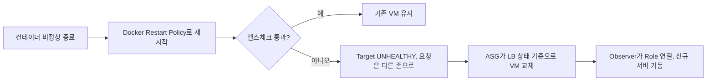

<!--
  NCP Multi Zone 전환 상세 본문. 표준: content/projects/STYLE.md
  출처: 포트폴리오 PDF(2026) PROJECT 01, 클라우드스퀘어 8월 현장실습 결과보고(260831), 현대오토에버 지원서
-->

> 온프레미스 서버 한 대에서 돌던 인사관리시스템을 NCP Multi Zone 3-Tier로 전환하고, 65GB 이전과 롤백 경로를 모의 환경에서 검증했다.

## 프로젝트 요약

| 항목 | 내용 |
| --- | --- |
| 소속 | 클라우드스퀘어 클라우드 2팀 현장실습 |
| 기간 | 2026.08 (약 1개월) |
| 형태 | 가상 고객사 시나리오 과제, 1인 |
| 역할 | Cloud Engineer |
| 담당 범위 | 요구사항 분석, 아키텍처 설계·구축, 운영 자동화, 이전·롤백 검증, 비용 산정 |

### 핵심 성과

- 장애 복구 30분 이상(전체 중단) → 설계 기준 10분 이내 (ASG 자동 교체, 교체 중에는 다른 존이 처리)
- Auto Scaling 신규 서버의 권한 연결부터 서비스 기동까지 자동화, 증설·교체 수동 작업 0건
- DB 25GB · 첨부파일 40GB를 3시간 안에 이전, 행 수·용량·SHA-256 불일치 0건
- 월 운영비 798,110원(VAT 포함)으로 예산 80만 원 이내 설계

### 주요 기여

- 고객사 요구사항 19개를 인프라 설계 조건으로 정리
- VPC 서브넷 13개, NACL·ACG 계층별 접근 통제 설계
- 헬스체크 판정 기준 재설계, Observer · Cloud Functions 기반 권한 자동 연결
- DMS · s3cmd 이전 절차와 역방향 복제 롤백 설계·검증

## 1. 프로젝트 개요

### 1.1 배경

가상 고객사 그린텍은 임직원 약 80명이 쓰는 인사관리시스템(HRMS)을 온프레미스 물리 서버 한 대에서 운영했다. WEB·WAS·DB가 한 서버의 Docker 컨테이너로 함께 실행되고, DB 약 25GB와 첨부파일 약 40GB를 로컬 디스크에 저장했다.

| 구분 | 평시 | 월말 |
| --- | --- | --- |
| 동시 사용자 | 15명 | 40명 (2.7배) |
| 일 트랜잭션 | 500건 | 3,000건 (6배) |

### 1.2 문제 정의

서버 한 대가 멈추면 OS와 애플리케이션을 다시 띄울 때까지 30분 이상 전체 서비스가 중단됐다. WEB·WAS·DB가 섞여 있어 월말 부하가 몰려도 필요한 계층만 늘릴 수 없었고, 증설·복구·로그 수집 같은 운영 작업은 사람 손에 의존했다. 인사정보와 첨부파일을 다루는데도 접근 통제와 감사 로그 체계가 없었다.

### 1.3 목표와 요구사항

과제의 목표는 단일 장애점이 있는 시스템을 분리·이중화·통제·관제할 수 있는 클라우드 운영 구조로 바꾸는 것이다.

| 영역 | 요구사항 |
| --- | --- |
| 구조 | WEB/WAS/DB 분리, 가용 영역 이중화, 관리형 DB, 월말 트랜잭션 6배 대응 |
| 이전 | 최대 중단 4시간, 전후 데이터 정합성 검증, 장애 시 온프레미스 롤백 |
| 보안 | DB 외부 접근 차단, 최소 권한, root SSH 차단, 관리자 접근 경로 단일화, well-known port 지양 |
| 운영 | 자원·장애 모니터링, ALB·WEB·WAS·DB·관리자 로그 1년 보관 |
| 비용 | 월 운영비 VAT 포함 80만 원 이하 |

### 1.4 제약 조건

- 실제 고객사 환경이 없어 온프레미스를 별도 VPC의 모의 환경으로 재현
- 예산 상한이 있어 피크 기준 자원을 상시 운영할 수 없음

## 2. 시스템 설계

### 2.1 전체 아키텍처

WEB·WAS·DB를 독립 계층으로 나누고 KR-1·KR-2 두 존에 이중 배치했다. 한쪽 존이 멈추면 ALB가 비정상 Target으로 요청을 보내지 않고 다른 존의 WEB·WAS가 처리한다. DB는 Primary 장애 시 Standby가 자동 승격되고, WAS는 Cloud DB 접속 도메인을 쓰므로 주소를 바꾸지 않는다.

외부 요청은 Public ALB에서만 받는다. WEB은 Private ALB를 거쳐 WAS를 호출하고, Cloud DB와 Object Storage에는 WAS만 접근한다.

### 2.2 설계 의사결정

| 결정 | 근거 |
| --- | --- |
| Public ALB와 Private ALB 분리 | WAS·DB를 외부에 노출하지 않고 WEB→WAS 통신도 존 이중화 |
| WEB은 존별 1대, 확장 없이 Auto Healing | 정적 자원 제공과 API 전달만 담당해 부하보다 장애 교체가 중요 |
| WAS는 기본 2대, 최대 4대 | 월말 부하가 업무 처리 계층에 집중 |
| Cloud DB 2vCPU · 8GB + HA | 현재 업무량에 고사양을 선할당할 근거가 없어 성능보다 장애 대응을 우선 |
| Read Replica 월 최대 30시간 | 월말 정산은 조회·조인·집계 중심. 정산 기간(업무 8시간 × 3.5일)에만 운영 |
| Bastion 월 30시간 | 관리 작업 시간에만 기동, HA 대상에서 제외 |
| Object Storage 용도별 버킷 | 첨부파일·로그·배포 아티팩트를 접근 권한과 보관 정책 기준으로 분리 |

처리 용량은 월말 3,000건이 30분에 몰린다고 가정해 산정했다. 3,000건 ÷ 1,800초는 약 1.67 TPS이고, 요청당 API 11회와 안전계수 3을 곱하면 약 50 RPS가 된다. WEB 2대는 서버당 약 25 RPS를, WAS는 기본 2대에서 서버당 25 RPS를 처리하고 4대로 늘면 12.5 RPS로 나뉜다. 서버는 컨테이너 기반 WEB·WAS에 맞춰 High CPU `c2-g3a`(2vCPU · 4GB)를 택했다.

관리자 접근 방식은 Bastion, SSL VPN, IPsec VPN을 관리자 규모, 접속 목적, 온프레미스 연결 필요성 기준으로 비교했다. 소수 관리자의 제한적인 작업이라 사용자 수에 따라 과금되는 SSL VPN이나 사이트 간 연결용 IPsec VPN보다 Bastion이 적합하다고 판단했다.

### 2.3 기술 스택

| 분류 | 기술 | 사용 목적 |
| --- | --- | --- |
| 컴퓨팅 | Server, Auto Scaling, Load Balancer | 존 이중화, 장애 서버 자동 교체, WAS 부하 확장 |
| 데이터 | Cloud DB for MySQL, Object Storage, Archive Storage | 관리형 DB HA, 첨부파일·로그 분리 보관 |
| 보안 | Secret Manager, Server Role, Certificate Manager | 런타임 Secret 조회, 서버 권한, 인증서 |
| 관측 | Cloud Insight, Cloud Log Analytics, Cloud Activity Tracer | 메트릭·로그·관리 이력 수집 |
| 자동화 | Observer, Cloud Functions | 신규 서버 권한 자동 연결 |
| 이전 | DMS, s3cmd | DB Full Load + CDC, 첨부파일 Full·Delta Sync |
| 런타임 | Docker | WEB(Nginx · Next.js) · WAS(Spring Boot) 컨테이너 |

## 3. 주요 구현

### 3.1 네트워크와 접근 통제

VPC `10.0.0.0/16`을 /24 서브넷 13개로 나누고 세 번째 옥텟을 1~13으로 순차 할당해 주소만으로 자원을 식별하게 했다. Public ALB와 Bastion만 Internet Gateway 경로를 갖고, Private 영역에는 상시 인터넷 경로를 두지 않았다. Object Storage는 Private Endpoint로 접근하고, NAT Gateway는 DMS 작업 기간에만 경로를 추가한 뒤 제거했다.

NACL은 서브넷 단위로 요청과 반환 경로를 각각 허용하고, ACG는 서버 단위로 필요한 포트만 연다. well-known port 대신 SSH 52147, WAS 41783, DB 19737을 쓴다. 관리자는 허용된 공인 IP에서 Bastion으로만 들어오고, 모든 서버에서 root 직접 로그인을 막고 개인 계정과 sudo를 쓴다.

### 3.2 표준 이미지와 런타임 Secret 주입

검증을 마친 WEB·WAS 서버를 Server Image로 만들고 Launch Configuration에 지정해, Auto Scaling 서버가 항상 같은 구성으로 뜨게 했다. 이미지와 스크립트에는 Secret을 넣지 않는다. 서버가 뜨면 Init Script가 Server Role 임시 자격 증명으로 Secret Manager를 조회하고, `/run/greentech/*.env` 환경 파일을 권한 600으로 만든 뒤 컨테이너를 실행하고 헬스체크까지 확인한다.

### 3.3 장애 복구 흐름과 Auto Scaling 정책

컨테이너 재시작으로 복구되면 VM을 유지하고, 복구되지 않을 때만 VM을 교체한다.

| 구분 | 조건 | 동작 |
| --- | --- | --- |
| Scale-out | WAS 평균 CPU 70% 초과 5분 | 해당 존 WAS 1대 추가, Cooldown 300초 |
| Scale-in | WAS 평균 CPU 10% 미만 10분 | 해당 존 WAS 1대 반납, Cooldown 600초 |

Scale-in Cooldown을 더 길게 잡아 일시적인 부하 감소로 서버가 바로 반납되는 현상을 막았다.

### 3.4 로그와 모니터링

ALB Access Log, Cloud DB Error·Slow Query, WEB·WAS·Bastion의 애플리케이션·인증 로그를 Cloud Log Analytics로 모은다. 최근 30일은 Cloud Log Analytics에서 검색하고, 원본은 로그 전용 버킷에 저장해 31일차에 Archive Storage로 옮기고 365일차에 삭제한다. Cloud DB Audit Log는 매일 01:30 Cloud Function이 로그 버킷으로 반출한다. 서버 CPU·메모리·파일시스템·Swap과 Cloud DB CPU·I/O Wait·접속 가능 여부·복제 지연은 WARNING·CRITICAL 두 단계로 감시한다.

### 3.5 마이그레이션 절차

DB·첨부파일·애플리케이션 특성에 따라 이전 방식을 나눴다. WEB·WAS 이미지는 `docker save`와 SHA-256 검증 후 `docker load`로 옮기고, DB는 DMS Full Load + CDC, 첨부파일은 s3cmd Full Sync + Delta Sync를 쓴다.

DB 이전 방식은 다섯 가지를 비교했다. mysqldump는 Import와 변경분 반영을 따로 해야 해 장애 시 보조 방식으로 남겼고, mydumper의 병렬 처리는 25GB에 과도했다. XtraBackup은 물리 백업 기반이라 관리형 DB 이전에 맞지 않았고, Native Replication은 초기 적재·복제·장애 대응을 직접 관리해야 했다. Export·Import·Replication을 통합 관리하는 NCP DMS를 최종 선택했다.

| 단계 | 시각 | 내용 |
| --- | --- | --- |
| DB 이전 (70분) | 토 22:00 | 업무 쓰기 중단, DMS 이전, 정합성 검증 |
| 파일 이전 (60분) | 토 23:10 | Replication 종료, 첨부파일 Full·Delta Sync |
| Cutover (20분) | 일 00:10 | 온프레미스 점검 모드 유지, NCP Public ALB로 전달 |
| Go-Live (30분) | 일 00:30 | NCP WEB·WAS 활성화, 쓰기 차단 해제 |

### 3.6 롤백 설계

전환 후에도 온프레미스를 Cold Standby로 보존하고, NCP를 단일 Writer로 둬 양쪽에서 동시에 쓰기를 처리하지 않게 했다. DNS만 되돌리면 전환 이후 데이터가 사라지므로, Cutover 이후 Cloud DB Binary Log의 최초 변경 위치를 Rollback Checkpoint로 기록하고 Bastion 경유 SSH Tunnel로 온프레미스 MySQL에 역방향 복제 채널을 만든다. 첨부파일은 경로·크기·MD5 기준으로 신규·변경 파일만 Reverse Sync한다. DNS TTL은 60초로 미리 낮추고, 온프레미스용 인증서는 Let's Encrypt DNS-01로 미리 발급했다.

롤백은 NCP 쓰기 차단 → 파일 최종 동기화 → DB 최종 동기화 → 온프레미스 Writer 전환 → DNS 원복 순서로 60분 안에 끝내도록 계획했다.

## 4. 트러블슈팅

### 4.1 DB 장애 시 정상 WAS까지 반복 교체

**현상** DB 연결이 끊기면 정상인 WAS도 Target DOWN이 되고, 새로 만든 WAS도 같은 DB에 붙어 다시 DOWN이 되면서 교체가 반복됐다.

**원인 분석** WAS 헬스체크로 쓴 `/actuator/health`가 `DataSourceHealthIndicator`를 포함해, DB 장애를 WAS 장애로 판정하고 HTTP 503을 반환했다.

**해결** 애플리케이션 생존만 확인하는 Liveness 엔드포인트 `/actuator/health/liveness`로 바꿔 DB 장애와 WAS 장애를 분리했다. DB 장애는 교체 조건에서 빼고 Cloud Insight 알림으로 받는다.

**검증** DB 장애 상황에서 WAS 교체가 일어나지 않고, WAS 자체가 응답하지 않을 때만 교체되는 것을 확인했다.

### 4.2 Next.js가 멈춰도 서버는 정상 판정

**현상** Next.js 컨테이너가 중단돼도 WEB Target은 UP으로 남았고, 사용자는 502를 받았다.

**원인 분석** 호스트 Nginx가 `/health`에 고정 200을 반환해, Nginx만 살아 있으면 Next.js 상태와 무관하게 정상으로 판정됐다.

**해결** `/health`를 Next.js 컨테이너(`http://127.0.0.1:3000/health`)로 프록시해 사용자 요청과 같은 경로로 판정하게 했다.

**검증** Next.js를 중단하면 Nginx upstream 연결이 실패해 Target이 DOWN이 되고, ASG가 WEB 서버를 교체하는 것을 확인했다.

### 4.3 Auto Scaling으로 만든 서버가 기동하지 못함

**현상** Auto Scaling으로 늘어난 VM이 헬스체크에 실패해 교체를 반복했다. VM 자체는 정상이었다.

**원인 분석** NCP Auto Scaling은 신규 서버에 Server Role을 자동 연결하지 않는다. Metadata API로 임시 자격 증명을 얻지 못해 Secret Manager 조회가 실패했고, 환경 파일이 만들어지지 않아 컨테이너가 DB 접속 정보 없이 기동하지 못했다. 증설·교체 때마다 관리자가 Role을 수동으로 연결해야 하는 운영 공백이었다.

**해결** 1분 주기로 서버를 조회해 Role을 붙이는 방식은 변화가 없어도 하루 최대 1,440회를 호출한다. 그래서 상태가 바뀔 때만 동작하는 이벤트 방식을 택했다. 서버가 RUN 상태가 되면 Observer가 감지하고, Cloud Function이 서버명 Prefix로 WEB·WAS를 판별해 공통 Runtime Server Role을 연결한다. Init Script는 Role 연결을 기다린 뒤 Secret 조회부터 헬스체크까지 진행한다.

**검증** 증설·교체로 생긴 서버가 수동 작업 없이 서비스에 합류했고, 서버에 Access Key를 저장하지 않았다.

## 5. 검증 및 성과

### 5.1 검증 방법

별도 VPC(`10.0.10.0/16`)에 모의 온프레미스를 만들어 실제 절차대로 이전했다. Ubuntu VM에 Docker MySQL로 약 25GB 데이터를 만들고 Binary Log(ROW·FULL)와 GTID를 설정했으며, 첨부파일은 약 40GB(47개 객체)를 구성했다. DB는 Source·Target에서 같은 검증 쿼리로 행 수와 논리 Payload를 비교하고, Source에 Marker를 추가해 Replication 반영을 확인했다. 파일은 이전 전 SHA-256 기준값과 Object Storage에서 내려받은 파일을 하나씩 비교했다.

### 5.2 결과

| 대상 | 결과 |
| --- | --- |
| DB 25GB | DMS 49분, 12,800행 · 논리 Payload 25.00GB 일치, 28개 테이블 통계 이상 없음 |
| 첨부파일 40GB | Full Sync 7분, Full 47개 · Delta 5개 SHA-256 전체 일치 |
| 롤백 | DB CRC32·행 수 일치, Reverse Sync 증분 5개 SHA-256 일치 |
| 전환 일정 | 3시간 작업 계획 (허용 중단 4시간) |
| 비용 | 월 798,110원 (VAT 포함, 백업·로그 보관·월말 증설 포함) |

| 비용 항목 | 기준 | 월 비용 |
| --- | --- | --- |
| Cloud DB for MySQL HA | 2대, 데이터 30GB, 백업 7일 | 384,456원 |
| WEB / WAS 서버 | 각 2대 상시 | 각 139,380원 |
| Public / Private ALB | 각 small 1대 | 각 18,720원 |
| Read Replica | 월 최대 30시간 | 4,608원 |
| WAS 확장분 | 추가 2대, 각 24시간 | 869원 |
