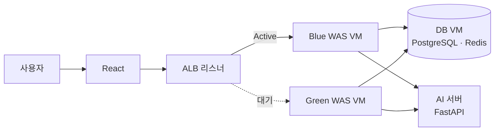

<!--
  WAYMORE(티미유) 상세 본문. 표준: content/projects/STYLE.md
  출처: 제8회 교육 공공데이터 AI 활용대회 티미유 홍보자료, teameeu-backend / frontend / ai 저장소
-->

> 교육 공공데이터와 생성형 AI로 진로 로드맵을 만드는 웹 서비스를 개발하고, ALB 대상 그룹 전환 기반 Blue-Green 배포를 설계·구현했다.

## 프로젝트 요약

| 항목 | 내용 |
| --- | --- |
| 소속 | 제8회 교육 공공데이터 AI 활용대회 (Team 티미유) |
| 기간 | 2026.03 ~ 2026.05 |
| 형태 | 3인 팀 |
| 역할 | Infra / Full-stack |
| 담당 범위 | AWS 인프라, Blue-Green 배포 자동화, Spring Boot 백엔드, React 프론트엔드 |

### 핵심 성과

- ALB 리스너 기준 Active 슬롯 판별 → 대기 슬롯 배포 → 헬스체크 → 대상 그룹 전환 자동화
- 헬스체크를 통과한 버전만 트래픽을 받는 배포 경로
- 백엔드 커밋 124건 중 123건, 프론트엔드 커밋 166건 중 120건 직접 작성

### 주요 기여

- ALB · Blue/Green WAS VM · DB VM · Bastion 인프라 구성
- GitHub Actions Blue-Green 배포 워크플로
- Spring Boot 백엔드(인증, 로드맵, 채팅, 커리어넷 API 연동)
- React 프론트엔드(진로검사, 로드맵, 대시보드 화면)

## 1. 프로젝트 개요

### 1.1 배경

커리어넷·학교알리미 같은 교육 공공데이터는 있지만, 학생 개인의 성적·적성과 통합되어 전달되지 않는다. 진로검사 결과는 "그래서 오늘 무엇을 해야 하는가"로 이어지지 않고, 개인화된 진로 설계는 고비용 컨설팅(50분 최대 100만 원)에 의존한다. 2024 초·중등 진로교육 현황조사에서 중학생 51%, 고등학생 43%가 희망 직업이 없는 이유로 "무엇을 좋아하는지 몰라서"를 꼽았다.

WAYMORE는 고교학점제 전환기의 중학생과 비교과 활동 계획이 막막한 고1~2를 대상으로 한다. 커리어넷 API 진로검사, 학기 단위 로드맵, 대시보드, RAG 기반 AI 상담을 제공한다.

[](/projects/waymore/features.jpg)

### 1.2 문제 정의

같은 VM에서 컨테이너를 재시작하는 방식으로 배포하면, 새 버전이 기동하는 동안 요청이 실패하고 새 버전에 문제가 있어도 바로 되돌릴 곳이 없다. 이 프로젝트에서는 Blue-Green 배포를 실제 서비스에 직접 설계·적용해 검증하는 것을 인프라 목표로 잡았다.

### 1.3 목표와 요구사항

- 새 버전은 대기 슬롯에서 먼저 기동하고, 헬스체크를 통과한 뒤에만 트래픽 전환
- 직전 버전은 대기 슬롯에 남겨 리스너 전환만으로 되돌릴 수 있는 구조
- 관리 접근은 Bastion으로 단일화, App VM의 SSH를 외부에 열지 않음

## 2. 시스템 설계

### 2.1 전체 아키텍처

사용자 요청은 프론트엔드(React)를 거쳐 ALB로 들어오고, ALB 리스너가 Blue 또는 Green 대상 그룹 중 하나로 전달한다. 두 슬롯은 각각 별도 VM에서 WAS(Spring Boot) 컨테이너를 실행한다. PostgreSQL 16과 Redis 7.4(AOF)는 별도 DB VM에서 Docker Compose로 운영하고, WAS는 FastAPI 기반 AI 서버의 추천·채팅 API를 서비스 토큰으로 호출한다.



### 2.2 설계 의사결정

| 결정 | 근거 |
| --- | --- |
| 서버 교체 대신 슬롯 전환 | 대기 슬롯에 먼저 띄우고 트래픽만 옮겨 기동 시간 동안의 요청 실패 방지 |
| ALB 리스너에서 Active 슬롯 조회 | 배포 상태를 따로 저장하지 않고 ALB를 단일 기준으로 삼아 상태 불일치 방지 |
| 헬스체크 통과 후 전환 | 뜨지 않은 버전으로 트래픽이 넘어가는 것을 차단, 실패 시 기존 슬롯이 계속 서비스 |
| 커밋 SHA 이미지 태그 | 운영 버전을 커밋 단위로 추적 |
| `concurrency` 그룹 | 연속 push 시 배포가 겹쳐 두 슬롯이 동시에 바뀌는 상황 방지 |
| Bastion 경유 배포 | CI도 관리자와 같은 접근 경로 사용, App VM SSH 비공개 |

### 2.3 기술 스택

| 분류 | 기술 | 사용 목적 |
| --- | --- | --- |
| 인프라 | AWS ALB, EC2, Bastion | Blue/Green 슬롯, 트래픽 전환, 관리 접근 |
| 배포 | GitHub Actions, Docker, Docker Hub | 이미지 빌드·배포, 슬롯 전환 |
| 백엔드 | Spring Boot, JWT | API, Access·Refresh 쿠키 인증 |
| 데이터 | PostgreSQL 16, Redis 7.4 | 서비스 데이터, 캐시 |
| 프론트엔드 | React | 진로검사·로드맵·대시보드 화면 |
| 외부 연동 | 커리어넷 Open API, AI 서버(FastAPI) | 진로검사, 추천·RAG 채팅 |

## 3. 주요 구현

### 3.1 Blue-Green 배포 워크플로

`main` · `dev` push 또는 PR 머지 시 GitHub Actions가 실행된다. 이미지를 빌드해 커밋 SHA(7자리) 태그로 푸시한 뒤, ALB 리스너 기본 동작에서 가중치 100인 대상 그룹을 조회해 현재 Active 슬롯을 판별하고 반대쪽 슬롯을 배포 대상으로 정한다.

배포 대상 VM에는 Bastion을 ProxyCommand로 경유해 접속한다. `.env.was`의 이미지 태그를 바꾸고 `docker compose pull`, `up -d`로 새 버전을 띄운 뒤 `/actuator/health`가 UP이 될 때까지 5초 간격으로 최대 10회 확인한다. 헬스체크를 통과해야만 ALB 리스너의 기본 동작을 새 대상 그룹으로 바꾼다.

```bash
ACTIVE_TG=$(aws elbv2 describe-listeners --listener-arns "$ALB_LISTENER_ARN" \
  --query "Listeners[0].DefaultActions[0].ForwardConfig.TargetGroups[?Weight==\`100\`][0].TargetGroupArn" \
  --output text)
# ... 대기 슬롯 배포, 헬스체크 통과 후
aws elbv2 modify-listener --listener-arn "$ALB_LISTENER_ARN" \
  --default-actions Type=forward,TargetGroupArn="$TARGET_TG"
```

### 3.2 백엔드

Spring Boot로 JWT(Access·Refresh 쿠키) 인증, 사용자·로드맵·채팅 API를 구현했다. 커리어넷 Open API 클라이언트는 응답 문자열 파싱, 외부 API 오류의 전용 예외 변환, API 키 누락 시 명확한 오류 응답을 처리한다. AI 서버의 추천·채팅 응답은 SSE 스트리밍으로 전달한다.

### 3.3 프론트엔드

React로 진로검사(카드 선택형 응답), 학기 단위 로드맵 타임라인, 대시보드 화면을 구현했다.

## 4. 트러블슈팅

### 4.1 회원가입 시 CORS 에러로 보이던 간헐적 504

**현상** 프론트에서 회원가입 요청 시 CORS 에러가 보였고, 같은 시점에 `504 Gateway Time-out`이 간헐적으로 발생했다.

**원인 분석** Preflight(OPTIONS)는 정상 응답했고, 실패한 POST의 응답 헤더는 `Server: awselb/2.0`이었다. CORS 정책이 아니라 업스트림 지연으로 ALB가 504를 반환한 것이고, 504 응답에는 CORS 헤더가 없어 브라우저가 CORS 에러로 함께 표시했다. 회원가입 트랜잭션은 이메일 확인 → 사용자 저장 → 로드맵 저장 → Redis 저장으로 길어, DB·Redis가 순간적으로 지연되면 요청 스레드가 대기로 묶였다.

**해결** CORS 설정이 `allowed-origins`와 `allowed-origin-patterns`를 함께 반영하도록 정리하고, HikariCP(`maximum-pool-size`, `connection-timeout`, `max-lifetime`)와 Redis(`connect-timeout`, `timeout`, Lettuce 풀) 설정을 명시해 지연 시 무한정 기다리지 않고 빠르게 실패하게 했다.

**검증** curl로 Preflight와 회원가입 POST를 반복 호출해 응답 코드와 헤더를 비교했다. 점검 기준은 ALB `TargetResponseTime`, `HTTPCode_Target_5XX_Count`, `UnHealthyHostCount`와 커넥션 풀 고갈 여부로 정리했다.

## 5. 검증 및 성과

### 5.1 검증 방법

배포마다 대기 슬롯의 `/actuator/health`가 UP이 되는지를 5초 간격 최대 10회 확인하고, 통과한 경우에만 리스너를 전환한다. 헬스체크가 실패하면 워크플로가 중단되고 기존 Active 슬롯이 계속 서비스한다.

### 5.2 결과

| 항목 | 결과 |
| --- | --- |
| 배포 방식 | 헬스체크 통과 후 ALB 대상 그룹 전환 |
| 배포 중 다운타임 | 0초 (트래픽은 기동이 끝난 슬롯으로만 전환) |
| 롤백 경로 | 직전 버전이 대기 슬롯에 남아 리스너 전환만으로 복귀 가능 |
| 서비스 | AWS 배포 후 진로검사·로드맵·AI 상담 시연 |
